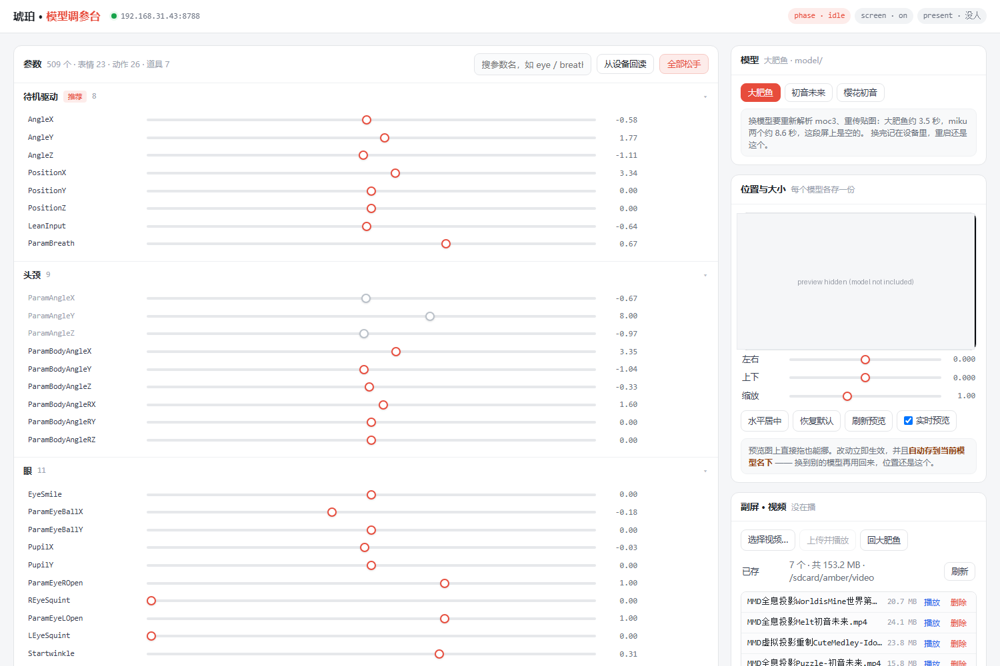
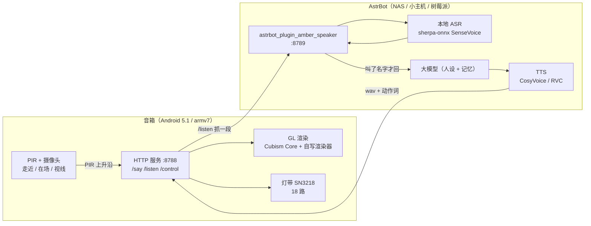

<div align="center">

# 狗尾草琥珀全息智能音箱 · 接入大肥鱼

**把一台被原厂放弃的桌面音箱，改成会看你、会动、会说话的全息桌面角色**


[快速开始](docs/DEPLOY.md) · [硬件针脚](docs/HARDWARE.md) · [AstrBot 接线](docs/ASTRBOT.md) · [可改设置](docs/SETTINGS.md) · [HTTP API](docs/API.md) · [故障排查](docs/TROUBLESHOOTING.md) · [发布包](https://github.com/gaozhen112233/amber-speaker/releases/latest)

</div>

一台 1024×600 的屏 + LED 灯带舞台 + 四麦阵列 + PIR 人体感应 + 一颗 MSM8909。  
原厂放弃项目，只剩蓝牙音箱的功能。这个项目把屏幕接管过来，用 Live2D 渲染一个角色，  
再把她接到 [AstrBot](https://github.com/AstrBotDevs/AstrBot) 上——于是她能听、会看、会说、能做动作。

> 她叫大肥鱼。这个项目想做的不是一台音箱，而是给她完整的一生。

---

## 她能做什么

| 能力         | 说明                                                  |
| ---------- | --------------------------------------------------- |
| **语音唤醒**   | 喊「大肥鱼」就能叫醒。按拼音匹配，容忍近音字（SenseVoice 会把她自己的名字识别成「大菲鱼」） |
| **连续对话**   | 应一声之后，20 秒内不用再喊名字；最多连续 4 轮，防电视声续聊                   |
| **走近唤醒**   | PIR 检测到人靠近，直接出声打招呼（不要求正对摄像头）                        |
| **在场搭话**   | 人在旁边待够 5 分钟，她主动理你；50 分钟冷却、只在 10:00–23:00            |
| **视线跟随**   | 说话和听的时候，眼睛跟着镜头里的人转（硬件人脸检测，不取帧、不落盘）                  |
| **AI 识物**    | 说「你看看我手里拿的什么」，她拍一帧交给视觉模型回答；默认不限次数、不限间隔（可调），不落盘 |
| **待机动作**   | 不是播动画，是持续驱动物理输入：呼吸、重心、尾巴、眼球微动，7 套节奏                 |
| **26 段动作** | 点头、歪头、晃尾巴、大幅度手势…… 由一句话里的〔动作词〕驱动                     |
| **灯带情绪**   | 18 路分路驱动：待机慢呼吸、在听时从中间荡开、说话随电平起伏、播视频时低亮               |
| **定时播报**   | 早上 8:40「早上好呀主人」、晚上 23:59「我去睡了」（时刻可改）                |
| **作息熄屏**   | 半夜自动熄屏关灯，只留语音唤醒（区间可改，支持跨午夜）                         |
| **全息 MMD 舞蹈视频** | 电脑传一段绿幕舞蹈视频过来，在她的画布上播，背景透明、灯带光能透上来，有立体感      |
| **三层自愈**   | GL 卡死 / 画面全黑 / 进程被杀，都会自己回来（含重装 APK 后的保活）            |
| **自动对时**   | 这台机器没有 RTC 电池，开机停在 1977 年；开机与每 6 小时自动校准             |

调参台（本地网页）可以把上面几乎每一项都改掉，不用重新编译：



> 截图里是作者的模型；仓库不含任何模型，见 [模型与版权](#模型与版权)。

---

## 它是怎么跑起来的



关键设计（也是踩了很多坑换来的）：

- **视频和模型共用一块 GL 画布**。切到舞蹈视频不销毁模型，切回来只要一帧；第三方播放器做不到透明底，也补不了这块屏需要的镜像。
- **唤醒识别必须本地**。云端往返 1.6–9.7 秒且会抖，本地 0.3–0.5 秒。
- **播放时不能开麦**。HAL 一开喇叭就拆掉采集流，`AudioRecord.read()` 连续失败；AEC 在这台机器上无解（见 [TROUBLESHOOTING](docs/TROUBLESHOOTING.md)）。

---

## 五分钟上手

前提：一台已 root（Magisk）的狗尾草琥珀音箱、一台装了 JDK 17 + Android SDK 的电脑、一台跑 AstrBot 的主机。

```bash
# 1. 编译（会自动探测 SDK / JDK，也可以用 ANDROID_HOME / JAVA_HOME 指定）
python jni/build.py      # 先编 native（需要自行下载 Live2D Cubism Core，见下）
python build.py          # 再出 APK

# 2. 装到音箱（USB 或无线 adb 都行）
adb install -r amber-speaker.apk
adb shell am start -n com.amber.speaker/.MainActivity

# 3. 确认她活了
curl http://<音箱IP>:8788/state
curl -X POST http://<音箱IP>:8788/say -d '你好呀'

# 4. 打开调参台（双击 tools/model_console/start_console.cmd，或）
python tools/model_console/server.py <音箱IP>:8788
```

完整步骤、每一步的验收判据、以及最容易卡住的地方，见 **[docs/DEPLOY.md](docs/DEPLOY.md)**。

---

## 目录

```
src/                  设备端 Java（39 个文件，纯 aapt2 + javac + d8 构建，不用 Gradle）
jni/                  native 渲染层（Cubism Core 适配 + 自写 OpenGL 渲染器）
tools/
  model_console/      本地调参台（Python 标准库 + 单页 HTML，无依赖）
  pack_models.py      把 Live2D 模型打包进 assets（贴图降采样到 2048）
  gen_big_motions.py  生成大幅度动作（原版动作幅度只有 6~19，看不出来）
  amber_keepalive.sh  Magisk 保活脚本
contrib/
  astrbot_plugin_amber_speaker/   把音箱接进 AstrBot 的消息平台插件
  astrbot_plugin_qq_plaintext/    QQ 侧去掉〔动作〕旁白（可选）
examples/             配置与格式示例
docs/                 部署、硬件、设置、接口、排障、二次开发
```

---

## 能改什么

三层，从「点几下」到「改代码」：

1. **调参台**（不用重启、不用编译）：灯带/背光/音量、作息区间、定时播报、在场搭话阈值与时段、接话窗口、视线跟随、模型与摆台、全息舞蹈视频、对时、重启。
2. **AstrBot 平台配置**：设备地址、监听端口、唤醒词、TTS 音色、语音概率、人设、记忆。
3. **代码常量**：口型映射、待机风格、动作幅度、灯带曲线、渲染批次策略。

完整清单（含默认值、范围、改完怎么验证）见 **[docs/SETTINGS.md](docs/SETTINGS.md)**。

---

## 文档

| 文档                                                 | 内容                                                        |
| -------------------------------------------------- | --------------------------------------------------------- |
| [docs/DEPLOY.md](docs/DEPLOY.md)                   | **从零部署**：系统准备 → Magisk → 权限 → 编译 → 安装 → 自启 → AstrBot → 验收 |
| [docs/HARDWARE.md](docs/HARDWARE.md)               | 这台机器的硬事实：屏幕方向、灯带协议、传感器、五个按键、电源                            |
| [docs/ASTRBOT.md](docs/ASTRBOT.md)                 | 插件配置逐项说明、语音闭环、TTS、QQ 双通道                                  |
| [docs/SETTINGS.md](docs/SETTINGS.md)               | 可改设置总表（调参台 / 插件 / 代码）                                     |
| [docs/API.md](docs/API.md)                         | 设备 HTTP 接口与调参台接口，含 curl 示例                                |
| [docs/TROUBLESHOOTING.md](docs/TROUBLESHOOTING.md) | 按现象查：没声音、没反应、全黑、第一遍丢……                                    |
| [docs/DEVELOPMENT.md](docs/DEVELOPMENT.md)         | 渲染管线、动作生成、模型适配、参数体系                                       |
| [docs/legacy-notes.md](docs/legacy-notes.md)       | 开发期的原始技术笔记（零散但信息密度高）                                      |

---

## 模型与版权

这个仓库**只包含代码**，不包含任何模型或音色：

- `assets/model*/`（Live2D 模型）与 `assets/voice/`（24 句预录应答）被 `.gitignore` 排除——**没有模型时 App 能启动，但画面会停在「模型加载失败」**；原版大肥鱼模型作者已免费放出，获取方式见 [DEPLOY §6.1](docs/DEPLOY.md)，只想先跑通链路也可以用 Live2D 官方样例（§6.2）；**没有预录音则喊她不应声**，见 [DEPLOY §6.4](docs/DEPLOY.md)；
- `jni/local/libLive2DCubismCore*.a` 是 Live2D 的专有 SDK，需要你从[官网](https://www.live2d.com/sdk/download/native/)下载后放进 `jni/local/`；
- 你放入的模型必须是你自己拥有或获得授权的作品。

代码本身是 MIT。详见 [LICENSE](LICENSE)。

Cubism SDK、Live2D 模型、音色模型与预录音频**不在这份 MIT 里**，各自的授权边界写在 [THIRD-PARTY.md](THIRD-PARTY.md)。

---

## 致谢

- [AstrBot](https://github.com/AstrBotDevs/AstrBot)：消息平台、人设、记忆、插件系统
- [Live2D Cubism SDK](https://www.live2d.com/sdk/)：模型与渲染核心
- [sherpa-onnx](https://github.com/k2-fsa/sherpa-onnx) + SenseVoice：本地语音识别
- [CosyVoice](https://github.com/FunAudioLLM/CosyVoice) / [RVC](https://github.com/RVC-Project/Retrieval-based-Voice-Conversion-WebUI)：语音合成与音色
- **大肥鱼 Live2D 模型**：美术 @神宫凉子、绑定 @霓虹猫_NeonNeko，人设 @ZipZipPipe / @上善无形（[免费公开](https://www.bilibili.com/video/BV1KmxY66EZ3/)，本仓库不转存）
- 以及所有在 issue 和日志里被反复 debug 的周末。

---

如果这个项目对你有帮助，或者你也在折腾同一台机器，欢迎点个 ⭐，或者开个 issue 说说你把它改成了什么样。
